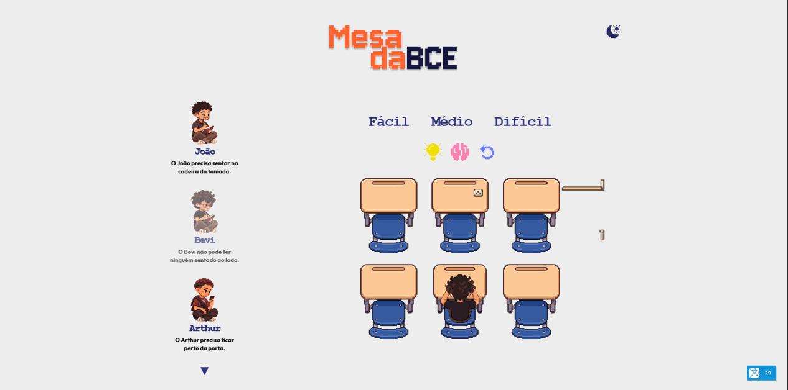

- **Nome do grupo:** Os Sem Agenda

- **Repositório:** [https://github.com/giovannafg/paradigmas-jogo](https://github.com/giovannafg/paradigmas-jogo)
- **Commit ou tag entregue:** `2e7cf81`

- **Ponto de partida:** jogo inventado

- **Slides da apresentação oral:** `docs/apresentacao.pdf` 


## 2. Resumo

A **Mesa da BCE** é um quebra-cabeça lógico para navegador: o jogador precisa sentar os integrantes de um grupo de estudos em cadeiras de uma sala, respeitando simultaneamente as manias de cada personagem. O **Prolog** define as regras, avalia as jogadas, gera fases com solução única, resolve estados e fornece dicas; o **Elm** mantém o estado da interface e renderiza o tabuleiro; o **FastAPI/Python** realiza a integração via HTTP e Janus.

O tabuleiro tem três níveis: **fácil (2×3, quatro personagens)**, **médio (3×3, cinco)** e **difícil (3×4, sete)** (`backend/prolog/bce.pl:460-462`). As mesas são desenhadas em linhas e colunas, com sprites de personagens e da tomada; a porta fica logicamente no canto superior direito e seu marcador aparece ao lado da primeira linha. A interface disponibiliza modo claro/noturno, seleção de dificuldade, dicas, solução automática, reinício, rolagem da lista de personagens e indicação visual de conflitos de regras.

As regras completas encontram-se em `docs/REGRAS.md`.



## 3. Como executar

**Requisitos:** SWI-Prolog 10.0.2 (9.2+), Node.js 24.14 com npm (20+), uv 0.11 e Python gerenciado pelo uv. Essas versões foram registradas pelo grupo; não foram verificadas nesta revisão.

```sh
git clone https://github.com/giovannafg/paradigmas-jogo.git
cd paradigmas-jogo
make install
make dev
```

Acesse `http://localhost:5173`; a documentação da API fica em `http://localhost:8000/docs`. O frontend solicita uma fase fácil ao iniciar; as dificuldades podem ser trocadas pelos botões na interface.

**No Windows, sem `make`:**

```sh
# Terminal 1 (backend)
cd backend
uv sync
uv run fastapi dev app/main.py

# Terminal 2 (frontend, a partir da raiz do projeto)
cd frontend
npm install
npm run dev
```

**Execução isolada do Prolog e testes:**

```sh
swipl backend/prolog/bce.pl
# No interpretador: generate(facil, Mesa, Amigos, Sentados), solve(Mesa, Amigos, Sentados, Solucao).

make test
# ou separadamente:
swipl -g run_tests -t halt backend/prolog/test_bce.pl
cd backend && uv run pytest
cd frontend && npx elm-test
```

**Testado em:** Windows 11, macOS 27.0.1 e Ubuntu 26.04.1.

## 4. Arquitetura

```text
Navegador (Elm + CSS/SVG, Vite)
      | HTTP/JSON
      v
FastAPI / Pydantic (backend/app/main.py)
      | Janus via backend/app/prolog.py
      v
SWI-Prolog (backend/prolog/bce_api.pl -> bce.pl)
```

O jogador seleciona um personagem e uma cadeira. `Main.elm` atualiza a interface e, quando necessário, chama `Api.elm`, que envia JSON para `/api/fase/jogada`. O FastAPI valida o pedido, chama a ponte Janus/Prolog e retorna um estado com `sentados`, `status` das manias e `venceu`. O Elm atualiza os sprites e as mensagens sem recalcular as manias, que continuam sob responsabilidade do Prolog.

| Parte | Responsabilidade | Arquivos |
|---|---|---|
| Prolog | Base de conhecimento, restrições CLP(FD), geração, avaliação das manias, dicas e solução | `backend/prolog/bce.pl`, `bce_api.pl`, `test_bce.pl` |
| Elm | Tipos do domínio, estado da partida, controles, renderização, feedback e HTTP | `frontend/src/Bce.elm`, `Main.elm`, `Api.elm` |
| JavaScript/CSS/SVG | Inicialização do Elm, persistência do tema no navegador, estilo pixel art e sprites | `frontend/src/main.js`, `style.css`, `frontend/public/sprites/` |
| Python | Validação e exposição das rotas HTTP e integração com Prolog | `backend/app/main.py`, `backend/app/prolog.py` |

## 5. Parte em Prolog

### 5.1 Predicados principais

| Predicado | Local | O que faz |
|---|---|---|
| `mania(?Amigo, ?Mania)` | `bce.pl:94` | Registra as regras dos sete personagens como fatos. |
| `restricoes(+Mesa, +Amigos, +Sentados, -Lugares)` | `bce.pl:270` | Impõe as restrições de cadeiras, dimensões e manias com CLP(FD). |
| `estado_valido(+Mesa, +Amigos, +Sentados)` | `bce.pl:338` | Verifica se o estado é estruturalmente válido. |
| `status_manias(+Mesa, +Amigos, +Sentados, -Status)` | `bce.pl:391` | Classifica cada mania como `ok`, `violada` ou `pendente`. |
| `solve(+Mesa, +Amigos, +Sentados, -Solucao)` | `bce.pl:434` | Completa a mesa respeitando as regras; usa `labeling([ff], Vars)`. |
| `count_solutions(+Mesa, +Amigos, +Sentados, +Limite, -N)` | `bce.pl:441` | Conta soluções até o limite para detectar unicidade. |
| `generate(+Nivel, -Mesa, -Amigos, -Sentados)` | `bce.pl:453` | Gera uma fase candidata válida e de solução única. |
| `objetos_aleatorios(+Linhas, +Colunas, -Objetos)` | `bce.pl:481` | Fixa a porta em `(0, Colunas-1)` e sorteia tomada e decoração nas demais cadeiras. |
| `hint(+Mesa, +Amigos, +Sentados, -Dica)` | `bce.pl:542` | Busca uma jogada forçada e sua justificativa, se houver. |

### 5.2 Conceitos do paradigma lógico utilizados

- [x] **Fatos e regras:** `amigo/1`, `objeto/1` e `mania/2` (`bce.pl:76-100`) definem entidades e manias. `mania_vale/4` (`bce.pl:177`) interpreta as condições declaradas.
- [x] **Unificação e casamento de padrões:** as cláusulas de `mania_vale/4` diferenciam termos como `sem_vizinhos`, `perto_de(Amigo)` e `na_cadeira_de(Objeto)`; `lugar_inicial/5` (`bce.pl:282`) unifica personagens e coordenadas.
- [x] **Recursão:** `rotulo_aleatorio/1` (`bce.pl:495`) percorre variáveis; `ancoras/5` (`bce.pl:507`) adiciona âncoras e `enxuga/5` (`bce.pl:515`) remove as dispensáveis.
- [x] **Backtracking e múltiplas soluções:** `solve/4` pode encontrar respostas sucessivas. `between(1,50,_)` (`bce.pl:455`) permite tentar outra fase candidata.
- [x] **Coleta e agregação:** `aggregate_all(count, limit(...), N)` (`bce.pl:441`) limita a contagem; `findall/3` é usado na seleção de amigos, lugares e domínios.
- [x] **Corte e negação:** `!/0` em `generate/4` (`bce.pl:457`) fixa a primeira candidata aceita; `\+/1` é usado em verificações de estado e busca de dicas.
- [x] **CLP(FD):** restrições de domínios, exclusividade de cadeiras, reificação `#<==>` e `labeling([ff], Vars)` (`bce.pl:126`, `bce.pl:270-302`, `bce.pl:438`).
- [x] **Predicados de ordem superior:** `maplist/2`, `maplist/3` em `restricoes/4` e seu auxiliar (`bce.pl:270-279`); `include/3`, `exclude/3` e `partition/4` também aparecem no código.
- [x] **Outros:** `random_permutation/2`, `random_member/2` para variar fases, `selectchk/3` na redução de âncoras e estados `ok/violada/pendente` derivados das mesmas regras.

### 5.3 Trecho em destaque

O gerador parte de uma configuração solucionável e tenta construir um enigma com **solução única**, evitando tanto fases ambíguas quanto fases impossíveis. As âncoras são participantes que já começam sentados.

```prolog
generate(Nivel, Mesa, Amigos, Sentados) :-
    nivel(Nivel, _, _, _, _),
    between(1, 50, _),
    fase_candidata(Nivel, Mesa, Amigos, Sentados),
    !.

ancoras(Mesa, Amigos, Candidatos, Ancoras0, Ancoras) :-
    (   count_solutions(Mesa, Amigos, Ancoras0, 2, 1)
    ->  Ancoras = Ancoras0
    ;   Candidatos = [Lugar | Resto],
        ancoras(Mesa, Amigos, Resto, [Lugar | Ancoras0], Ancoras)
    ).

enxuga(_, _, [], Ancoras, Ancoras).
enxuga(Mesa, Amigos, [Lugar | Resto], Ancoras0, Ancoras) :-
    selectchk(Lugar, Ancoras0, Sem),
    (   count_solutions(Mesa, Amigos, Sem, 2, 1)
    ->  enxuga(Mesa, Amigos, Resto, Sem, Ancoras)
    ;   enxuga(Mesa, Amigos, Resto, Ancoras0, Ancoras)
    ).
```

`ancoras/5` adiciona posições da solução até que só reste uma configuração válida. `enxuga/5` tenta retirar essas posições sem perder a unicidade. `count_solutions/5` precisa encontrar no máximo duas soluções para distinguir uma solução única de várias. O Prolog cuida da busca e do backtracking: o programa declara as restrições que definem a validade do estado, em vez de implementar manualmente uma sequência de tentativas de cadeiras. O limite de 50 candidatas em `generate/4` é uma **limitação**: se nenhuma passar, a geração falha.

Na atualização visual, o gerador também passou a fixar o objeto lógico `porta` na primeira linha e última coluna (`bce.pl:481-488`): `(0,2)` nos níveis fácil e médio e `(0,3)` no difícil. O sprite mostrado no frontend não altera essa referência lógica. A tomada e a decoração são sorteadas em outras posições.

## 6. Parte em Elm

### 6.1 Modelo e mensagens

O módulo `Bce.elm` contém tipos e funções puras de domínio; `Api.elm` codifica/decodifica o JSON; `Main.elm` reúne o estado da tela, atualizações e renderização. Os tipos fechados evitam combinações inválidas e os `case` exaustivos ajudam o compilador a detectar estados não tratados.

```elm
type alias Model =
    { tela : Tela
    , darkTheme : Bool
    , aguardando : Bool
    }

type Tela
    = Inicio
    | FalhaInicial String
    | PartidaAberta Partida

type Msg
    = AcaoJogo Acao
    | RecebeuFase Dificuldade (Result String Fase)
    | RecebeuEstado Consulta (Result String Estado)
    | RecebeuDica (Result String Dica)
    | TemaAlterado Bool
    | DescerPersonagens
    | RecebeuPosicaoPersonagens (Result Browser.Dom.Error Browser.Dom.Viewport)
    | RolagemConcluida
```

Trechos de `Main.elm:17-77`. `Model` guarda a tela, o tema e se há requisição pendente. O registro `Partida` (`Main.elm:30`) guarda fase, dificuldade, estado, seleção, desfecho, dicas, conflito recente, erro e aviso. `Tela` impede que uma partida inexistente seja tratada como jogável; `Result` separa sucesso e falha de HTTP; `Maybe` indica dica ou aviso ausente. `Acao` representa as ações do jogador, enquanto `Msg` também representa respostas HTTP e a rolagem da lista.

Em `Bce.elm`, destacam-se `Amigo` (`:63`), `Objeto` (`:73`), `Mania` (`:217`), `Recusa` (`:276`), `StatusMania` (`:384`) e `Rodada` (`:432`). `sentar` e `levantar` retornam `Result Recusa (List Lugar)` (`:310`, `:331`), sem exceções para regras de ocupação.

### 6.2 Conceitos do paradigma funcional utilizados

- [x] **Arquitetura Elm:** `main`, `init`, `update` e `view` (`Main.elm:80`, `:90`, `:96`, `:408`) implementam o ciclo Model–Update–View.
- [x] **Custom types e `case` exaustivo:** `Amigo`, `Mania`, `Recusa`, `Tela`, `Acao` e `Msg` representam conjuntos fechados de possibilidades.
- [x] **`Maybe` e `Result`:** `Bce.amigoDeTexto` (`:161`) devolve `Maybe Amigo`, `Bce.maniaDeTexto` (`:556`) devolve `Result String Mania`, e as respostas da API são recebidas como `Result String ...`.
- [x] **Funções de ordem superior:** `List.map`, `List.filter`, `List.concatMap`, `List.foldr` e `Result.map` aparecem no domínio, no processamento de manias e na renderização.
- [x] **Composição:** operadores `|>` em `Bce.elm`, `Main.elm` e `Api.elm` compõem transformações sem variáveis mutáveis.
- [x] **JSON:** decoders e encoders em `Api.elm:162-382` traduzem fase, lugares, objetos, status, dicas e pedidos HTTP para tipos do domínio.
- [x] **Efeitos controlados:** `Cmd Msg` e `Http` no `Api.elm` realizam requisições; `Browser.Dom` e `Task` em `Main.elm` controlam a rolagem da lista. `subscriptions = always Sub.none` no programa atual.
- [x] **Imutabilidade:** atualizações `{ model | ... }` e `{ partida | ... }` em `Main.elm` criam novos estados em vez de mutar objetos existentes.
- [x] **Separação de lógica e apresentação:** `Bce.elm` reúne operações puras, enquanto CSS/SVG e `Main.view` cuidam do aspecto da interface.

### 6.3 Trecho em destaque

```elm
maniaDeTexto : String -> List String -> Result String Mania
maniaDeTexto tipo alvo =
    case ( tipo, alvo ) of
        ( "perto_de_objeto", [ objeto ] ) ->
            objetoOuErro objeto |> Result.map PertoDeObjeto

        ( "sem_vizinhos", [] ) ->
            Ok SemVizinhos

        ( "de_frente_para_algum", amigos ) ->
            amigos
                |> List.map amigoOuErro
                |> combina
                |> Result.map DeFrentePara

        _ ->
            Err ("Mania desconhecida: " ++ tipo)

combina : List (Result e a) -> Result e (List a)
combina =
    List.foldr (Result.map2 (::)) (Ok [])
```

Trecho **resumido** de `Bce.elm:556` e `:626`; o código-fonte trata os sete tipos de mania. O `case` sobre uma tupla exige combinação válida entre o nome e a lista de alvos. `combina` transforma uma lista de resultados em um único resultado, propagando um erro caso exista, sem laço explícito nem mutação.

As atualizações do frontend mantêm esse modelo: `viewLinhaMesas` cria as linhas da matriz; `viewCadeira` escolhe o sprite correspondente ao personagem e à tomada; `viewMensagens` mostra a regra em conflito; o destaque amarelo indica dicas e o vermelho indica violações; `TemaAlterado` troca a paleta; e `DescerPersonagens` solicita ao `Browser.Dom` o deslocamento da lista. Os sprites ficam em `frontend/public/sprites/` e o tema é persistido por `frontend/src/main.js` usando `localStorage`.

## 7. Integração

O navegador se comunica com FastAPI por HTTP/JSON. O backend valida o formato com Pydantic, chama `bce_api.pl` via Janus e converte os dados de volta para JSON. O Prolog é a fonte das regras; o Python não calcula manias.

| Rota | Entrada | Saída | Lógica Prolog |
|---|---|---|---|
| `POST /api/fase/nova` | `{dificuldade}` | Mesa, amigos, fixos e manias | `generate/4` |
| `POST /api/fase/estado` | `{fase, sentados}` | Estado, status e vitória | `estado_valido/3`, `status_manias/4`, `venceu/3` |
| `POST /api/fase/jogada` | Fase, sentados, amigo, linha e coluna | Estado após jogada | `jogada_valida/5` e estado |
| `POST /api/fase/dica` | `{fase, sentados}` | Amigo, posição e motivo | `hint/4` |
| `POST /api/fase/resolver` | `{fase, sentados}` | Estado solucionado | `solve/4` |

O formato completo está em `docs/API.md`. Requisições inválidas são respondidas com HTTP 422 pela validação dos modelos ou das regras da API; o Elm apresenta a mensagem de erro retornada.

## 8. Testes e validação

Existem três conjuntos de testes automatizados no repositório:

- **Prolog (plunit):** `backend/prolog/test_bce.pl` cobre validade estrutural do estado, cadeiras ocupadas, regras/manias, vitória, solução, geração, unicidade e dicas. Há testes de coordenadas negativas, cadeiras fora da mesa, personagens desconhecidos e tentativas de sentar em posições ocupadas.
- **Python (pytest):** `backend/tests/test_api_bce.py` cobre os endpoints de fase, estado, jogada, dica e resolução, incluindo requisições inválidas e os tamanhos dos níveis 2×3, 3×3 e 3×4.
- **Elm (elm-test):** `frontend/tests/MainTest.elm` e `ApiTest.elm` verificam transições de estado, interações, erros e conversão entre JSON e tipos Elm.

Os comandos de execução estão na seção 3. 

## 9. Limitações e problemas conhecidos

- **Geração probabilística:** `generate/4` testa até 50 candidatas. Se nenhuma satisfizer os critérios, a geração pode falhar (`bce.pl:453-457`).
- **Alguns conflitos são estados intermediários:** o jogo permite sentar personagens ainda que manias sejam violadas, para que o jogador reorganize a mesa. Os estados `violada` e `pendente` não devem ser confundidos; a interface apresenta uma explicação do conflito.
- **Compatibilidade visual:** a experiência usa sprites SVG e estilos responsivos; a disposição em telas muito estreitas requer validação manual. A porta é um marcador gráfico próximo à mesa superior direita, não um elemento interativo independente.
- **Persistência:** o tema fica salvo no `localStorage`, mas a partida não possui persistência entre recargas; a inicialização carrega uma nova fase fácil (`Main.elm:90-93`).
- **Melhorias desejáveis:** automatizar testes da interface, melhorar comportamento da lista ao chegar ao fim e ampliar as verificações de acessibilidade em navegação por teclado e dispositivos móveis.

## 10. Contribuição de cada integrante

| Integrante | Principais contribuições | Pull Requests |
|---|---|---|
| Arthur Ribeiro e Sousa | Implementou a dica (`hint`) que aponta a mania responsável por forçar a jogada e escreveu os testes plunit das regras e casos de borda, corrigindo o `estado_valido`. | [#26](https://github.com/giovannafg/paradigmas-jogo/pull/26), [#27](https://github.com/giovannafg/paradigmas-jogo/pull/27) |
| Felipe Lopes Pedroza | Criou o módulo puro de tipos do domínio em Elm e redigiu as seções 6.2 e 6.3 do relatório (parte Elm). | [#29](https://github.com/giovannafg/paradigmas-jogo/pull/29), [#30](https://github.com/giovannafg/paradigmas-jogo/pull/30) |
| Gabriel Dantas Bevilaqua Mendes | Implementou o resolvedor (`solve`/`count_solutions`) e o gerador de fases com solução única em Prolog, documentou as seções 5.1 a 5.3 do relatório e limpou o que restava do template do Sudoku. | [#24](https://github.com/giovannafg/paradigmas-jogo/pull/24), [#25](https://github.com/giovannafg/paradigmas-jogo/pull/25), [#36](https://github.com/giovannafg/paradigmas-jogo/pull/36), [#37](https://github.com/giovannafg/paradigmas-jogo/pull/37) |
| Gabriel Henrique Castelo Costa | Implementou a tela da Mesa da BCE em Elm, ligando a interface às rotas da API. | [#33](https://github.com/giovannafg/paradigmas-jogo/pull/33) |
| Giovanna Felipe Guimarães | Montou o ponto de partida do repositório e a API FastAPI (rotas de fase, estado, jogada, dica e resolver, com testes), o `Api.elm` com requisições, decoders e encoders, além da documentação de regras e da seção 7 do relatório. | [#23](https://github.com/giovannafg/paradigmas-jogo/pull/23), [#31](https://github.com/giovannafg/paradigmas-jogo/pull/31), [#32](https://github.com/giovannafg/paradigmas-jogo/pull/32) |
| João Victor Felix Moreira | Refez o frontend do jogo (UI/UX: layout, temas, sprites e feedback visual) e atualizou o relatório com as seções finais. | [#39](https://github.com/giovannafg/paradigmas-jogo/pull/39) |
| Mayara Marques Silva | Escreveu o CONTRIBUTING.md com os combinados do grupo, modelou em Prolog a mesa, os amigos e as manias do jogo, ajustou o limite de tamanho da mesa e o motivo da dica, e redigiu as seções 1 a 4 do relatório. | [#21](https://github.com/giovannafg/paradigmas-jogo/pull/21), [#22](https://github.com/giovannafg/paradigmas-jogo/pull/22), [#35](https://github.com/giovannafg/paradigmas-jogo/pull/35) |

## 11. Fontes, código de terceiros e uso de IA

**Código reaproveitado.** No código existem bibliotecas tanto no frontend quanto no backend. 

**Referências técnicas:** documentação oficial do [SWI-Prolog](https://www.swi-prolog.org/pldoc/), [Elm](https://guide.elm-lang.org/), [FastAPI](https://fastapi.tiangolo.com/) e [Vite](https://vite.dev/). São referências recomendadas para registrar os conceitos; o grupo deve confirmar quais efetivamente consultou.

**Uso de ferramentas de IA:** o grupo utilizou assistentes de IA como apoio ao longo das etapas de desenvolvimento — esclarecimento de dúvidas sobre as linguagens e bibliotecas usadas, sugestões de implementação em Prolog e Elm, ajustes de layout e estilo no frontend, apoio na escrita de testes e revisão de texto da documentação e do relatório. Em todos os casos o uso foi de apoio: as decisões de modelagem e de arquitetura foram do grupo, e todo o código sugerido foi lido, adaptado e validado pelos integrantes antes de entrar no repositório.

| Ferramenta | Para que foi usada | Como o resultado foi verificado |
|---|---|---|
| Assistentes de IA (ChatGPT e similares) | Apoio nas etapas de desenvolvimento: dúvidas de linguagem e bibliotecas, sugestões de implementação em Prolog e Elm, ajustes de frontend, apoio na escrita de testes e revisão da documentação | Revisão do código pelos integrantes, compilação do projeto, execução dos testes automatizados (plunit e elm-test) e testes manuais do jogo antes de abrir cada pull request |

## 12. Apresentação oral

**Slides:** pendente de confirmação; `docs/apresentacao.pdf` 

**Roteiro sugerido (15 minutos):**

| Parte | Duração | Responsáveis |
|---|:---:|---|
| Contexto e objetivo | 2 min | Definir pelo grupo |
| Demonstração dos níveis, temas, dicas e conflitos | 5 min | Definir pelo grupo |
| Prolog: restrições, geração e unicidade | 3 min | Definir pelo grupo |
| Elm: tipos, update e renderização | 3 min | Definir pelo grupo |
| Limitações e aprendizados | 2 min | Definir pelo grupo |

A distribuição de falas deverá ser aprovada por todos os integrantes.

## 13. Reflexão sobre os paradigmas

No Prolog, a principal vantagem foi modelar o que caracteriza uma configuração correta sem programar todas as tentativas de alocação. As manias funcionam como relações e restrições, e o mecanismo de busca consegue encontrar soluções ou detectar impossibilidade. Em contrapartida, a geração aleatória de fases com solução única e a distinção entre restrições satisfeitas, violadas e pendentes exigiram atenção especial.

No Elm, a vantagem foi representar o domínio por tipos fechados e controlar os efeitos por mensagens. Em vez de modificar a tela diretamente, cada evento produz um novo estado e a `view` o transforma em interface. Essa arquitetura ajudou a isolar as mudanças visuais — matriz de mesas, sprites, modo noturno, dicas, erros e rolagem — sem reimplementar no navegador as regras do Prolog.

O projeto evidencia a complementaridade entre os paradigmas: o lógico define e procura estados válidos; o funcional organiza a interação de maneira previsível e tipada. A integração HTTP permite que cada linguagem se concentre em suas características, com o custo adicional de converter dados e sincronizar os estados das camadas.